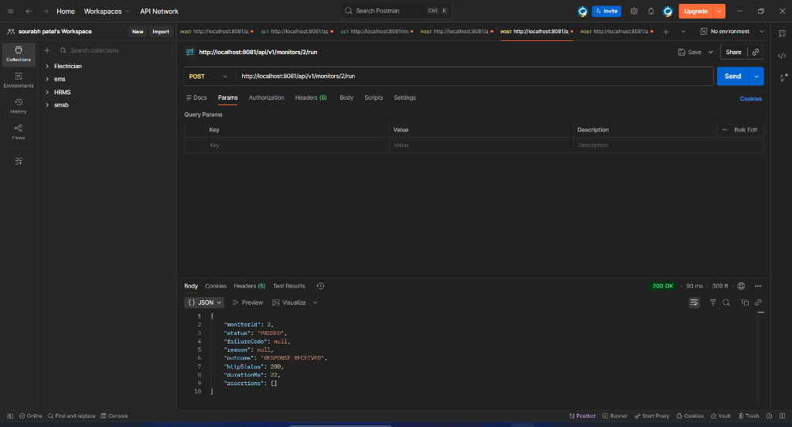
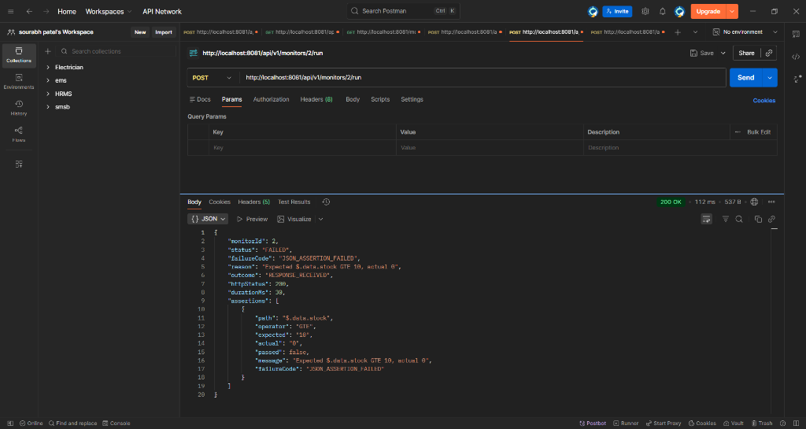

 
# API Sentinel
 
**Detects silent API failures: responses that return HTTP 200 but carry wrong, malformed, or stale data.**
 
Normal uptime monitors only check whether an API answered with `200 OK`. API Sentinel checks whether the API is actually *working*, using business rules you configure per endpoint.
 
## The problem
 
| Case | HTTP status | Data | Uptime monitor | API Sentinel |
|---|---|---|---|---|
| Healthy | 200 | Valid | OK | OK |
| Silent failure | 200 | Empty list / `stock = 0` | OK (missed) | **FAILED** |
| Stale data | 200 | 30 minutes old | OK (missed) | **FAILED** |
 
## Features
 
- **Configurable monitors**: URL, method, interval, timeout, expected status. Pause, resume, edit, delete.
- **Assertion engine**: JSONPath rules (`$.data.stock >= 10`) with a whitelist of operators (`EQ, NEQ, GT, GTE, LT, LTE, EXISTS, NOT_EMPTY, AGE_LTE`). User input is never executed, only compared.
- **JSON Schema validation**: catches missing fields and type drift (e.g. `"stock": "15"` instead of `15`). Remote `$ref` is blocked.
- **Freshness checks**: flags data older than a configured age.
- **Explainable failures**: structured failure codes (`STATUS_MISMATCH`, `SCHEMA_VIOLATION`, `JSON_ASSERTION_FAILED`, `STALE_DATA`, `TIMEOUT`, `BLOCKED_TARGET`, ...) with expected vs actual values.
- **Concurrent scheduler**: DB-backed, uses `FOR UPDATE SKIP LOCKED`, bounded thread pool with backpressure, and an overlap guard.
- **Incident engine**: 3 consecutive failures open one incident, 2 consecutive passes resolve it. Repeated failures never create duplicate incidents (enforced by a partial unique index).
- **Webhook alerts**: sent only on state change, HMAC-SHA256 signed, retry with exponential backoff.
- **SSRF protection**: resolved-IP validation, private/link-local/cloud-metadata blocking, per-hop redirect validation.
- **Check history**: append-only, paginated, indexed on `(monitor_id, started_at)`.
### Example: a silent failure
 
```json
{
  "status": "FAILED",
  "failureCode": "JSON_ASSERTION_FAILED",
  "reason": "Expected $.data.stock GTE 10, actual 0",
  "httpStatus": 200
}
```
 
## Quick start
 
Requirements: Docker Desktop.
 
```bash
git clone https://github.com/Its-sourabh86/api-sentinel-backend.git
cd api-sentinel-backend
 
# create .env (never commit it)
cp .env.example .env        # Windows: copy .env.example .env
# then edit .env and set POSTGRES_PASSWORD and SENTINEL_WEBHOOK_SECRET
 
docker compose up --build
```
 
The API is available at `http://localhost:8081`.
 
> The compose file sets `SENTINEL_ALLOW_PRIVATE_TARGETS=true` so the built-in mock API on `localhost` can be monitored. **Never enable this in production.**
 
### Try it
 
```bash
# 1. create a monitor against the built-in mock API
curl -X POST http://localhost:8081/api/v1/monitors \
  -H "Content-Type: application/json" \
  -d '{"name":"Inventory","url":"http://localhost:8081/mock/inventory/123?stock=15","intervalSeconds":10,"timeoutMs":3000}'
 
# 2. add a business rule: stock must be >= 10
curl -X POST http://localhost:8081/api/v1/monitors/1/assertions \
  -H "Content-Type: application/json" \
  -d '{"path":"$.data.stock","operator":"GTE","expectedValue":10}'
 
# 3. run a check now
curl -X POST http://localhost:8081/api/v1/monitors/1/run
```
 
Change the monitor URL to `...?stock=0` and run again: HTTP is still 200, but the check is `FAILED`.
 
## API overview
 
| Method | Endpoint | Purpose |
|---|---|---|
| POST / GET | `/api/v1/monitors` | Create / list monitors |
| GET / PATCH / DELETE | `/api/v1/monitors/{id}` | Read / update / delete |
| POST | `/api/v1/monitors/{id}/pause`, `/resume`, `/run` | Lifecycle and manual check |
| POST / GET / DELETE | `/api/v1/monitors/{id}/assertions` | Manage rules |
| PUT / GET / DELETE | `/api/v1/monitors/{id}/schema` | JSON Schema |
| GET | `/api/v1/monitors/{id}/results` | Paginated check history |
| GET | `/api/v1/incidents?status=OPEN` | Incidents |
 
## Architecture
 
```
Scheduler (tick every 5s)
   | claims due monitors (FOR UPDATE SKIP LOCKED)
   v
Bounded worker pool --> Probe executor (timeouts, size limit, SSRF guard)
                              |
                              v
                     Validation engine (status -> JSON -> schema -> assertions)
                              |
                              v
                 PostgreSQL: check_results (append-only)
                              |
                              v
                   Incident engine (open / dedupe / resolve)
                              | after commit
                              v
                 Webhook dispatcher (HMAC, retry, own thread pool)
```
 
Modular monolith: one Spring Boot app, separated into packages by feature.
 
**Stack:** Java 21, Spring Boot, Spring Data JPA, PostgreSQL, Flyway, Docker, JUnit 5, Mockito, Testcontainers, JaCoCo, GitHub Actions.
 
## Design decisions
 
- **DB polling scheduler instead of Quartz.** The `monitors` table is the single source of truth, so pause, resume and delete need no extra sync. `SKIP LOCKED` lets multiple instances share work without duplicates.
- **At-most-once checks.** `next_run_at` is advanced before the probe runs. If the app crashes mid-check, one check is skipped rather than duplicated.
- **Incident deduplication in two layers.** App-level check plus a partial unique index (`UNIQUE (monitor_id) WHERE status = 'OPEN'`), so races cannot create two open incidents.
- **Hysteresis.** Open after 3 failures, close after 2 passes, to avoid flapping alerts.
- **No DB transaction during HTTP calls**, so slow targets cannot exhaust the connection pool.
- **Alerts after commit** (`AFTER_COMMIT`), on a separate pool, so a slow webhook never blocks monitoring.
- **SSRF:** the resolved IP is validated, not the hostname. Redirects are followed manually and every hop is re-validated.
- **Secrets** come from environment variables. Responses, URLs and tokens are never logged.
## Tests
 
- 75 automated tests (unit tests with Mockito, real HTTP servers for the prober and webhook sender, Testcontainers PostgreSQL for the Spring context).
- Line coverage (JaCoCo): `[TBD]`
- CI runs on every push via GitHub Actions.
Run locally: `./mvnw clean verify` (Docker must be running for Testcontainers).
 
## Limitations and roadmap
 
Being honest about what this is not:
 
- **DNS rebinding** is reduced but not fully prevented (validate-then-connect). Full fix: connect to the validated IP or restrict network egress.
- **Webhook delivery is best-effort.** Pending alerts are in memory; a crash can lose them. Production fix: outbox pattern.
- **No authentication** on the API yet.
- **No dashboard UI** yet.
- Not load-tested yet; no throughput numbers are claimed.
- Manual `/run` currently counts toward incidents; pausing a monitor with an open incident does not auto-resolve it.


### Demo: before and after

The mock API returns HTTP 200 with `stock = 0`.

**Before** (no business rule): a plain uptime check sees `200 OK` and reports success.



**After** (rule `$.data.stock >= 10`): Sentinel catches the silent failure and explains why.

